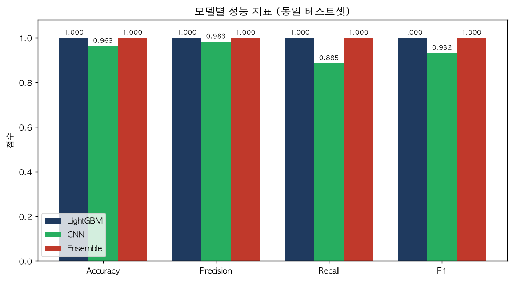
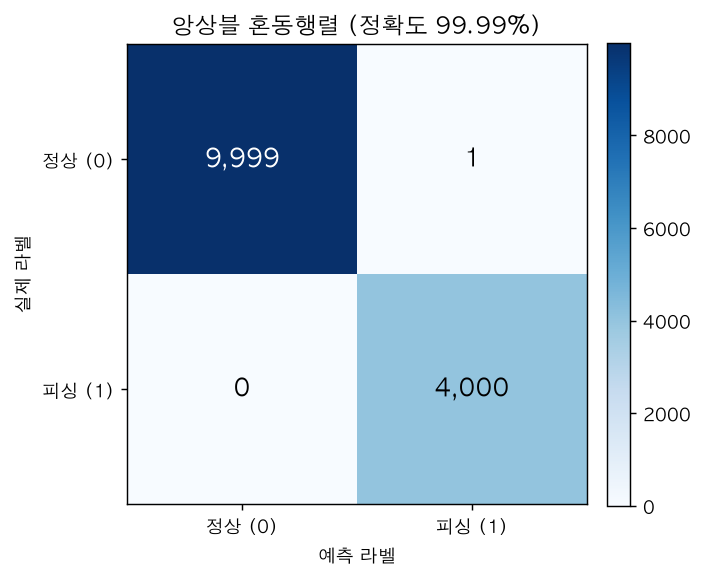
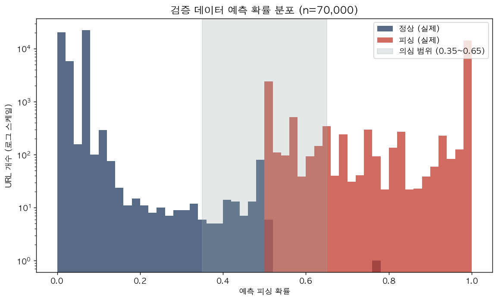

# 머신러닝·딥러닝 앙상블을 활용한 피싱 사이트 탐지

WHS 2기 **떡밥팀** 최종 프로젝트를 코드·데이터 중심으로 정리한 저장소입니다.
URL 에서 추출한 15개 피처(수치형 14개 + URL 토큰)를 이용해 **LightGBM(머신러닝)** 과 **1D-CNN(딥러닝)** 을 학습하고,
두 모델의 예측 확률을 평균한 **앙상블**로 피싱 여부를 판별합니다.

> 발표자료: [`docs/떡밥팀_최종발표.pdf`](docs/떡밥팀_최종발표.pdf)
> 이 문서는 발표 목차(개요 → 수행 → 성과 → 추후 계획) 순서를 따릅니다.

## 목차
- [01. 프로젝트 개요](#01-프로젝트-개요)
- [02. 프로젝트 수행](#02-프로젝트-수행)
- [03. 프로젝트 성과](#03-프로젝트-성과)
- [04. 추후 계획](#04-추후-계획)
- [저장소 구조](#저장소-구조) · [실행 환경](#실행-환경)

---

## 01. 프로젝트 개요

### 프로젝트 배경
- 피싱 사이트의 수법이 갈수록 다양해지고 있음
- **블랙리스트 방식으로는 피싱 공격의 약 20%를 막지 못해** 탐지가 어려움
- 피해액이 조 단위를 넘고, 국가가 피싱 사이트 제작을 지원할 만큼 규모가 커짐
- 개인뿐 아니라 기업도 피해 대상이 됨

### 프로젝트 소개
**피싱 사이트**란 정상 웹사이트를 가장한 사기 사이트로, 사용자를 속여 개인·금융 정보를 빼내는 것이 목적입니다.
외관이 거의 동일해 눈으로는 구분이 어렵지만, 아래와 같은 **차이**가 존재합니다.

| 구분 | 정상 사이트 | 피싱 사이트 |
| --- | --- | --- |
| 보안 인증서 | HTTPS 사용 | HTTP만 사용하거나 유효하지 않은 인증서 |
| 콘텐츠 | — | 정상과 거의 동일하나 일부 차이 |
| URL | 정상 도메인 | 유사하지만 미묘하게 다름 (예: `gabia.com` vs `gabiaing.com`) |

→ 이런 특징들을 **머신러닝·딥러닝 앙상블 모델**에 학습시켜 탐지하는 프로젝트입니다.

### 프로젝트 진행 요약
| 주차 | 내용 |
| --- | --- |
| 1주차 | Kick-off 및 URL 수집 |
| 2~5주차 | 데이터 전처리 · 모델 설계 |
| 6주차 | 모델 학습 & 테스트 + 오류 수정 |
| 7주차 | 데이터셋 모델 평가 |
| 8주차 | 결과 시각화 및 최종 보고서 작성 |

- 주 1회 온라인 멘토링, 격주 오프라인/온라인 미팅 진행
- **사전 계획 100% + α 달성**

---

## 02. 프로젝트 수행

### 1. 데이터 수집
- 정상 URL 약 **150,000개**
- 피싱 URL 약 **139,994개**

원본 URL 목록은 [`data/raw/`](data/raw) 에 있습니다. (정부기관·AWS 정상 사이트 등)

### 2. 피처 제작
URL 문자열, WHOIS 정보, 실제 페이지 접속을 통해 **15개 피처(수치형 14개 + URL 토큰)** 를 추출합니다.
모든 추출 함수는 [`src/features.py`](src/features.py) 한 모듈로 정리되어 있습니다.

| # | 컬럼 | 의미 | 계산 방식 |
| --- | --- | --- | --- |
| 1 | `IP_LIKE` | URL 에 IP 주소 형식 포함 여부 | 문자열 |
| 2 | `AT` | `@` 포함 여부 | 문자열 |
| 3 | `URL_Depth` | 경로(`/`) 깊이 | 문자열 |
| 4 | `Redirection` | 프로토콜 이후 `//` 리디렉션 의심 | 문자열 |
| 5 | `Is_Https` | https 사용 여부 | 문자열 |
| 6 | `TINY_URL` | 단축 URL 서비스 사용 여부 | 문자열 |
| 7 | `Check_Hyphen` | `-` 포함 여부 | 문자열 |
| 8 | `Query` | 쿼리 파라미터 개수 | 문자열 |
| 9 | `Domain_Age` | 도메인 생성일(2년 기준) | WHOIS |
| 10 | `Domain_end` | 도메인 만료일(5개월 기준) | WHOIS |
| 11 | `Mouseover` | `onmouseover` 태그 존재 | HTTP |
| 12 | `Web_forwards` | 웹 포워딩(리디렉션) 횟수 | HTTP |
| 13 | `Hyperlinks` | 페이지 내 `<a>` 태그 수 | HTTP |
| 14 | `Domain_Cons` | 접속 전후 도메인 일관성 | HTTP |
| 15 | `Tokenized_url` | URL 토큰열(텍스트 모델 입력) | 문자열 |

> 값 규칙(대체로): `0` = 의심, `-1` = 정상 간주, `1` = 피싱 의심. 네트워크 계열은 실패 시 `-1`.

**URL 목록 → 피처 데이터셋 생성:**
```bash
# 문자열 기반 피처만 (빠름, 네트워크 불필요)
python src/build_dataset.py data/raw/normal_data.csv out.csv --no-network

# 전체 피처 (WHOIS/HTTP 요청 포함, 느림)
python src/build_dataset.py data/raw/normal_data.csv out.csv
```

### 3. AI 모델 개발
```
데이터 수집 → URL 추출 → 피처 수집 → 데이터셋 생성(정상 0 / 피싱 1) → ML·DL 앙상블
```

- **머신러닝 — LightGBM** : `Tokenized_url` 을 CountVectorizer 로 벡터화하고 수치형 피처와 결합해 학습 (학습 정확도 약 1.0)
- **딥러닝 — 1D-CNN** : URL 을 토큰화 → Embedding + Conv1D 로 학습 (학습 정확도 약 0.99)

```bash
python src/train_lgbm.py --data data/final/valid_data.csv --model-out lgbm_model.joblib
python src/train_cnn.py  --data data/final/valid_data.csv --model-out cnn_best.keras
```

---

## 03. 프로젝트 성과

### 1. 검증 데이터 추가 수집
학습에 쓰지 않은 **별도 검증 데이터**를 추가로 수집했습니다.
- 정상 URL **50,000개**
- 피싱 URL **20,000개**

→ 전체 피처가 포함된 [`data/final/valid_data.csv`](data/final/valid_data.csv) (70,000건)

### 2. 앙상블 모델 개발
검증 데이터를 계층적 8:2 로 나눠(학습 56,000 / 테스트 14,000) **LightGBM · CNN · 앙상블**을
동일한 테스트셋에서 학습·평가했습니다. 아래 결과는 한 번의 실행으로 재현됩니다.

```bash
python src/run_comparison.py   # 세 모델 학습 + docs/images/*.png 생성
```

| 모델 | Accuracy | Precision | Recall | F1 |
| --- | --- | --- | --- | --- |
| LightGBM | 1.000 | 1.000 | 1.000 | 1.000 |
| CNN | 0.963 | 0.983 | 0.885 | 0.932 |
| **앙상블** | **0.9999** | **0.9998** | **1.000** | **0.9999** |



앙상블은 두 모델의 예측 확률을 평균(soft voting)하여 CNN 단독보다 재현율을 끌어올립니다.
테스트 14,000건에 대한 앙상블 혼동행렬은 오분류 1건으로 정확도 약 100%입니다.



### 3. 개발 결과 시각화
피싱 확률을 계산하고, 확률대별로 **정상 / 의심 / 피싱** 세 구간으로 분류합니다.
가운데 회색 구간이 **의심 범위(0.35~0.65)** 로, 정상/피싱이 확률 양극단으로 뚜렷하게 분리됩니다.



> 재학습한 세 모델의 테스트셋 예측값은 [`data/final/model_comparison.csv`](data/final/model_comparison.csv) 에 저장됩니다.
> (발표 당시 결과 원본은 [`data/final/model_percentage.csv`](data/final/model_percentage.csv) — 이 파일의 `CNN 예측값` 컬럼은
> 저장 과정에서 누락되어 있어, 위 비교는 CNN 을 새로 학습시킨 결과를 사용합니다.)

---

## 04. 추후 계획
발표자료 마지막 장의 계획에 이어, 이 저장소에서 가능한 개선 방향은 다음과 같습니다.

- 실시간 탐지를 위한 **API / 브라우저 확장** 형태로 서비스화
- WHOIS·HTTP 기반 피처의 **캐싱·병렬화**로 대량 URL 처리 속도 개선
- 학습 데이터에 대한 CNN 하이퍼파라미터 튜닝 및 최신 텍스트 모델(BERT 등) 비교
- 피처 추가 및 피처 중요도 기반 경량화

---

## 저장소 구조
```
phishing-url-detection/
├── src/
│   ├── features.py        # 15개 URL 피처 추출 함수 (핵심 재사용 모듈)
│   ├── build_dataset.py   # URL 목록 → 피처 데이터셋(CSV) 생성
│   ├── train_lgbm.py      # LightGBM 학습·평가
│   ├── train_cnn.py       # 1D-CNN 학습·평가
│   ├── ensemble.py        # 저장된 두 모델로 앙상블 평가 (+ 의심 범위 분류)
│   └── run_comparison.py  # 세 모델 학습·비교 + 결과 이미지 생성 (재현용)
├── data/
│   ├── raw/               # 원본 URL 목록
│   ├── features/          # 피처 추출 중간 산출물
│   └── final/             # 최종 학습·검증 데이터 및 결과 (설명: data/README.md)
└── docs/
    ├── 떡밥팀_최종발표.pdf
    └── images/            # 결과 시각화 이미지
```

## 실행 환경
```bash
pip install -r requirements.txt
```
주요 의존성: pandas, numpy, scikit-learn, lightgbm, tensorflow, requests, beautifulsoup4, python-whois

> 학습 산출물(`.venv/`, `*.joblib`, `*.keras`)은 `.gitignore` 로 제외됩니다. `python src/run_comparison.py` 한 번이면 재현됩니다.

## 팀
WHS 2기 떡밥팀 — 박찬민, 김주령, 김해찬, 김현진, 이경림, 이소영, 홍혜원 (멘토: 손승호)

## 라이선스
학습·연구 목적의 프로젝트 아카이브입니다.
