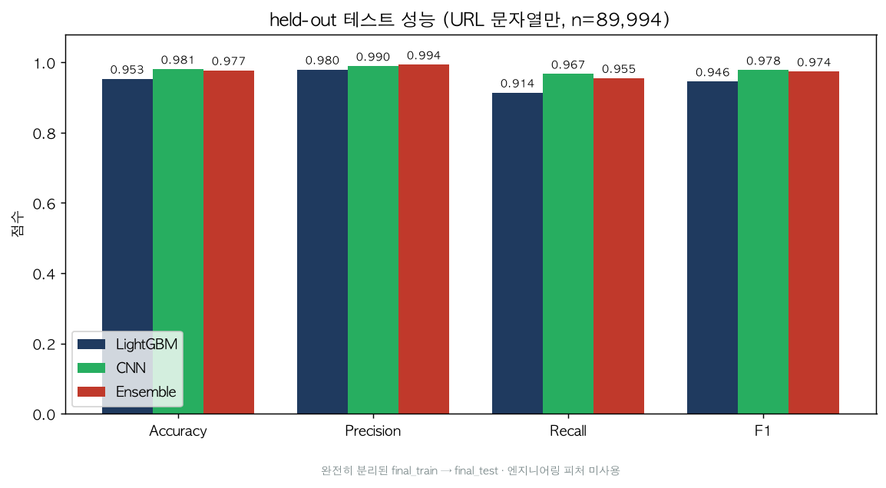
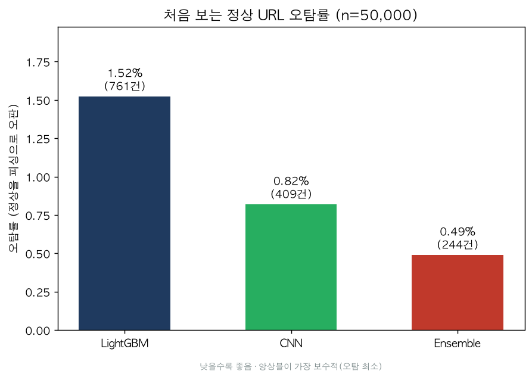

# 피싱 URL 탐지 — 머신러닝·딥러닝 앙상블

URL에서 뽑은 피처로 LightGBM(머신러닝)과 1D-CNN(딥러닝)을 학습하고, 두 모델의 예측 확률을 평균한 앙상블로 피싱 사이트를 판별하는 프로젝트입니다.

발표 당시에는 정확도 1.0에 가까운 결과를 보고 그대로 마무리했습니다. 이후 평가가 정확도에만 기대고 있었다는 점을 돌아보고, 학습과 완전히 분리된 데이터로 다시 검증했습니다.

- **데이터 누수 발견**: 테스트 URL의 44%가 학습셋에도 들어 있었습니다. 발표 때의 높은 점수는 실제 환경보다 낙관적인 수치였습니다.
- **URL 문자열만 쓰면 CNN이 가장 우수**: held-out 정확도 CNN 0.981, 앙상블 0.977, LightGBM 0.953. LightGBM의 1.0은 알고리즘보다 WHOIS·HTTP 피처 덕분이었습니다.
- **앙상블의 실제 장점은 오탐 최소화**: 처음 보는 정상 URL 50,000개 중 피싱으로 잘못 판단한 수가 앙상블 244개로 가장 적었습니다. (CNN 409개, LightGBM 761개)

## 프로젝트 정보

| 항목 | 내용 |
| --- | --- |
| 기간 | 2024.05 ~ 2024.08 (2024.07.14 최종 발표) · 2026.08 개인 재검증 |
| 소속 | WHS(화이트햇 스쿨) 2기 떡밥팀 프로젝트 |
| 팀 | 팀원 8명, 멘토 1명 |
| 역할 | 데이터 수집·정제 |

## 내가 한 일

**팀 프로젝트 (2024)**
- **데이터 수집·정제**: 논문에서 정리한 피처 정의에 맞춰, 수집한 URL 목록을 모델 입력용 DataFrame으로 바꾸는 정제 코드를 작성하고 데이터셋을 구성했습니다.

**개인 재검증 (2026)**
- **코드 정리**: 피처 추출 함수를 `src/features.py` 한 모듈로 정리하고, URL 목록에서 데이터셋을 만드는 스크립트(`build_dataset.py`)를 두었습니다.
- **평가 지표 확장**: 정확도 외에 Precision·Recall·F1과 혼동행렬로 세 모델(LightGBM, CNN, 앙상블)을 같은 테스트셋에서 비교했습니다. 발표 당시 저장되지 않은 CNN 예측값은 CNN을 다시 학습해 채웠습니다.
- **held-out 검증과 누수 발견**: 학습·테스트 파일을 완전히 분리해 다시 평가하면서, 테스트 URL의 44%가 학습셋과 겹친다는 것을 찾았습니다. 이를 바탕으로 앙상블이 실제로 어떤 경우에 도움이 되는지 다시 정리했습니다. (`src/holdout_experiment.py`)

## 문제와 접근

**문제** — 피싱 수법이 다양해지면서 블랙리스트 방식으로는 피싱 공격의 약 20%를 막지 못합니다. 피싱 사이트는 정상 사이트와 겉모습이 거의 같아 눈으로 구분하기도 어렵습니다.

**접근** — 정상 사이트와 피싱 사이트는 겉모습이 비슷해도 다음과 같은 차이가 있습니다. 이 차이를 피처로 만들어 모델에 학습시켰습니다.

| 구분 | 정상 사이트 | 피싱 사이트 |
| --- | --- | --- |
| 보안 인증서 | HTTPS 사용 | HTTP만 쓰거나 유효하지 않은 인증서 |
| URL | 정상 도메인 | 비슷하지만 미묘하게 다름 (예: `gabia.com` vs `gabiaing.com`) |
| 콘텐츠 | 원본 콘텐츠 | 정상과 거의 같지만 일부 차이 |

## 데이터와 피처

| 데이터 | 정상 URL | 피싱 URL | 용도 |
| --- | --- | --- | --- |
| 수집 데이터 | 약 150,000개 | 약 139,994개 | 학습 |
| 추가 검증 데이터 (`valid_data.csv`) | 50,000개 | 20,000개 | 발표 당시 모델 비교 |

원본 URL 목록은 [`data/raw/`](data/raw)에, 단계별 데이터 설명은 [`data/README.md`](data/README.md)에 있습니다.

URL 문자열, WHOIS 정보, 실제 페이지 접속으로 15개 피처(수치형 14개 + URL 토큰)를 만듭니다. 추출 함수는 모두 [`src/features.py`](src/features.py)에 있습니다.

| # | 컬럼 | 의미 | 계산 방식 |
| --- | --- | --- | --- |
| 1 | `IP_LIKE` | URL에 IP 주소 형식 포함 여부 | 문자열 |
| 2 | `AT` | `@` 포함 여부 | 문자열 |
| 3 | `URL_Depth` | 경로(`/`) 깊이 | 문자열 |
| 4 | `Redirection` | 프로토콜 이후 `//` 리디렉션 의심 | 문자열 |
| 5 | `Is_Https` | https 사용 여부 | 문자열 |
| 6 | `TINY_URL` | 단축 URL 서비스 사용 여부 | 문자열 |
| 7 | `Check_Hyphen` | `-` 포함 여부 | 문자열 |
| 8 | `Query` | 쿼리 파라미터 개수 | 문자열 |
| 9 | `Domain_Age` | 도메인 생성일(2년 기준) | WHOIS |
| 10 | `Domain_end` | 도메인 만료일(5개월 기준) | WHOIS |
| 11 | `Mouseover` | `onmouseover` 태그 존재 | HTTP |
| 12 | `Web_forwards` | 웹 포워딩(리디렉션) 횟수 | HTTP |
| 13 | `Hyperlinks` | 페이지 내 `<a>` 태그 수 | HTTP |
| 14 | `Domain_Cons` | 접속 전후 도메인 일관성 | HTTP |
| 15 | `Tokenized_url` | URL 토큰열(텍스트 모델 입력) | 문자열 |

> 값 규칙(대체로): `0` = 의심, `-1` = 정상 간주, `1` = 피싱 의심. 네트워크 계열은 실패 시 `-1`.

## 모델

```
URL 수집 → 피처 추출 → 데이터셋 생성(정상 0 / 피싱 1) → LightGBM · 1D-CNN → 확률 평균(앙상블)
```

- **LightGBM**: `Tokenized_url`을 CountVectorizer로 벡터화하고 수치형 피처와 합쳐 학습
- **1D-CNN**: URL을 토큰화해 Embedding + Conv1D로 학습
- **앙상블**: 두 모델의 피싱 확률을 평균(soft voting). 확률 0.35~0.65는 "의심" 구간으로 따로 분류

## 결과

### 1. held-out 검증 — URL 문자열만 사용 (2026 재검증)

학습 파일(`final_train.csv`, 중복 제거 후 약 16만 건)과 테스트 파일(`final_test.csv`, 89,994건)을 완전히 분리해 평가했습니다. 두 파일에는 URL과 레이블만 있어 WHOIS·HTTP 피처 없이 URL 문자열 신호만 씁니다.

| 모델 | Accuracy | Precision | Recall | F1 |
| --- | --- | --- | --- | --- |
| LightGBM | 0.953 | 0.980 | 0.914 | 0.946 |
| **CNN** | **0.981** | 0.990 | **0.967** | **0.978** |
| 앙상블 | 0.977 | **0.994** | 0.955 | 0.974 |



처음 보는 정상 URL 50,000개에 대한 오탐(정상을 피싱으로 판단)은 앙상블이 가장 적었습니다. 재현율을 조금 양보하는 대신 불필요한 차단을 줄이는 보수적인 성향입니다.



### 2. 발표 당시 설정 — 15개 피처 사용

발표 때와 같은 추가 검증 데이터 70,000건을 계층적 8:2로 나눠(학습 56,000 / 테스트 14,000) 세 모델을 같은 테스트셋에서 비교했습니다. 같은 파일 안에서 나눈 실험이고, WHOIS·HTTP 피처까지 모두 씁니다. 발표 원본에는 CNN 예측값이 저장되지 않아, 아래 수치는 2026년에 CNN을 다시 학습해 얻은 결과입니다.

| 모델 | Accuracy | Precision | Recall | F1 |
| --- | --- | --- | --- | --- |
| LightGBM | 1.000 | 1.000 | 1.000 | 1.000 |
| CNN | 0.963 | 0.983 | 0.885 | 0.932 |
| **앙상블** | **0.9999** | **0.9998** | **1.000** | **0.9999** |


피싱 확률 분포를 보면 정상과 피싱이 양 끝으로 뚜렷하게 나뉘고, 가운데 회색 구간이 의심 범위(0.35~0.65)입니다.


### 3. 두 실험을 비교해 알게 된 것

| 실험 | 1등 | 앙상블 | 꼴등 |
| --- | --- | --- | --- |
| 발표 당시 설정 (피처 사용) | LightGBM 1.0000 | 0.9999 | CNN 0.963 |
| held-out (URL만) | CNN 0.981 | 0.977 | LightGBM 0.953 |

- **피처가 없으면 순위가 뒤집힙니다.** LightGBM의 1.0은 알고리즘보다 엔지니어링 피처의 힘이었습니다.
- **앙상블은 어느 실험에서도 1등이 아니었습니다.** 한 모델이 확실히 강하면 앙상블은 성능을 끌어올리기보다 희석합니다. 앙상블은 두 모델이 비슷하게 강하면서 서로 다른 실수를 할 때 효과가 있고, 이 데이터에서는 그 조건이 맞지 않았습니다.
- **앙상블이 앞선 지점은 오탐**입니다. 차단을 보수적으로 해야 하는 서비스라면 이 성향이 장점이 될 수 있습니다.

## 한계와 다음 단계

- **누수가 피싱 쪽에 몰려 있음**: held-out 테스트의 피싱 URL 39,994개 중 39,967개가 학습셋에도 있었습니다. 처음 보는 URL은 사실상 정상 URL뿐이라, 표의 피싱 재현율은 새로운 피싱 URL에 대한 성능을 보여주지 못합니다. 학습과 겹치지 않는 피싱 URL을 새로 모아 다시 평가해야 합니다.
- **발표 당시 설정의 조건**: 같은 파일을 나눠 평가했고 피처를 모두 썼기 때문에, 1.0에 가까운 점수는 실제 환경보다 낙관적입니다.
- **다음 단계**: 실시간 탐지를 위한 API·브라우저 확장, WHOIS·HTTP 피처의 캐싱·병렬화, BERT 등 최신 텍스트 모델과의 비교, 피처 중요도 기반 경량화

## 실행 방법

```bash
pip install -r requirements.txt
```

주요 의존성: pandas, numpy, scikit-learn, lightgbm, tensorflow, requests, beautifulsoup4, python-whois

```bash
# URL 목록 → 피처 데이터셋 (문자열 피처만, 네트워크 불필요)
python src/build_dataset.py data/raw/normal_data.csv out.csv --no-network
# 전체 피처 (WHOIS/HTTP 요청 포함, 느림)
python src/build_dataset.py data/raw/normal_data.csv out.csv

# 모델 개별 학습
python src/train_lgbm.py --data data/final/valid_data.csv --model-out lgbm_model.joblib
python src/train_cnn.py  --data data/final/valid_data.csv --model-out cnn_best.keras

# 결과 재현
python src/run_comparison.py      # 발표 당시 설정으로 세 모델 비교 + 이미지 생성
python src/holdout_experiment.py  # held-out 검증
```

학습 산출물(`.venv/`, `*.joblib`, `*.keras`)은 `.gitignore`로 제외됩니다.

## 저장소 구조

```
phishing-url-detection/
├── src/
│   ├── features.py            # 15개 URL 피처 추출 함수
│   ├── build_dataset.py       # URL 목록 → 피처 데이터셋(CSV) 생성
│   ├── train_lgbm.py          # LightGBM 학습·평가
│   ├── train_cnn.py           # 1D-CNN 학습·평가
│   ├── ensemble.py            # 저장된 두 모델로 앙상블 평가 (+ 의심 범위 분류)
│   ├── run_comparison.py      # 세 모델 비교 + 결과 이미지 생성 (valid_data)
│   └── holdout_experiment.py  # 누수 인지 held-out 검증
├── data/
│   ├── raw/                   # 원본 URL 목록
│   ├── features/              # 피처 추출 중간 산출물
│   └── final/                 # 최종 데이터와 예측 결과 (설명: data/README.md)
└── docs/
    ├── 떡밥팀_최종발표.pdf
    └── images/                # 결과 시각화 이미지
```

발표자료: [`docs/떡밥팀_최종발표.pdf`](docs/떡밥팀_최종발표.pdf)

## 라이선스

학습·연구 목적의 프로젝트 아카이브입니다.
